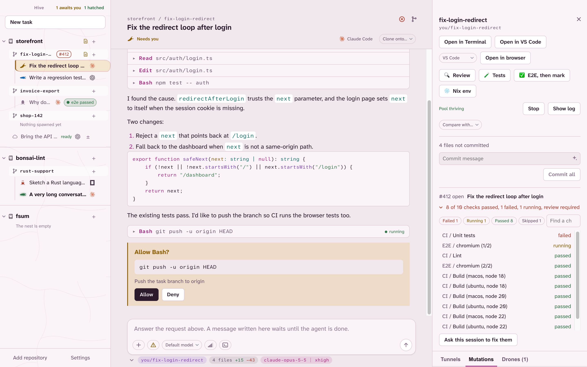

# Swarmed


**Run coding agents side by side, each on a branch and in a worktree of its own.**

Give Swarmed a git repository and say what you want done. It creates a branch and a worktree for
the task, sets it up with ports of its own, and starts an agent there: Claude Code, Codex,
OpenCode, Antigravity or any agent that speaks the Agent Client Protocol. Run several tasks at
once: each has its own worktree and ports, so they don't step on each other. A desktop app and a
`swarmed` command, over one Rust core.


## Why this one

- **A task is a branch, a worktree and a stack.** Your setup hook runs in each new worktree,
  your dev server keeps running beside it, and every task gets ports of its own, so two of them
  can run the same app at once.
- **Any agent, on its own login.** Claude Code runs as you set it up, with your login,
  settings and plugins. Others are installed and set up from Settings → Agents. Swarmed never
  signs you in to anything and keeps no GitHub token: it uses each agent's own login and your
  `gh`.
- **One pool of MCP servers and skills.** A server set up for Claude Code, Codex or OpenCode
  reaches the other agents too, and so does a skill, without copying anything into their
  configuration.
- **Supervise from one window.** Permission requests, questions and plans are answered in the
  conversation, and a notification says when a session needs you.
- **Answers you can see.** An agent can answer with HTML, such as a chart, a table or a mock-up,
  and Swarmed shows it in the conversation, in a sandbox with no way out to the app or the
  network.
- **From prompt to pull request.** The task's diff, comments on lines sent back to the agent,
  commit, push, and a pull request with its checks.
- **Made yours, by hand or by an agent.** Six palettes and a layout of your own sizes, fonts and
  colours; the terminal and the status line; buttons that send a prompt or run a command; saved
  prompts, rules for every agent, and environments for setting tasks up. Change them in the app,
  in their files or with `swarmed`, or ask an agent: it changes the looks at once, and proposes
  rules, environments and commands for your yes.
- **No files of its own in your repository.** Swarmed keeps its configuration and state in a
  folder of its own. The repository gains only the tasks' branches (and an empty first commit
  if it had none), and their worktrees live under `~/swarmed`.

<picture>
  <source media="(prefers-color-scheme: dark)" srcset="docs/images/app-dark.png">
  
</picture>

## Install

```sh
curl -fsSL https://raw.githubusercontent.com/ryckakas/swarmed/main/install.sh | sh
```

puts Swarmed.app in `/Applications` (`~/Applications` when that cannot be written to) and links
the `swarmed` command into `~/.local/bin`. Run it again to update. Or with Homebrew, which puts
`swarmed` on the PATH as well:

```sh
brew install --cask ryckakas/tap/swarmed
```

`cargo install swarmed` builds the command alone. The releases are built for macOS so far, so
elsewhere that is how to get the command.

Swarmed is not signed with an Apple Developer ID yet. Installed with Homebrew or downloaded by
hand, macOS stops it the first time it opens: allow it under System Settings → Privacy & Security
→ Open Anyway.

## Get started

Swarmed runs agents you have installed and signed in to yourself; Claude Code is the default.
Open the app, add a repository, start a task and say what the agent should do. The app speaks
in swarm words until Settings → Appearance switches it to plain ones: adding a repository is
**Found a colony**, a new task **New brood**.

Or from a terminal:

```sh
swarmed project add ~/code/shop
swarmed task new shop fix-login
swarmed session run shop fix-login "Fix the login form's error message"
```

## Documentation

- [Projects and configuration](docs/configuration.md): hooks, ports, environments and where
  Swarmed keeps things
- [Coding agents](docs/coding-agents.md): adding agents, MCP servers, skills, and the tools
  Swarmed gives them
- [The `swarmed` command](docs/command.md)
- [Architecture and development](docs/architecture.md): how it is built, and building it
- [Security](SECURITY.md): what Swarmed keeps, what it hands on, and reporting a vulnerability
- [Changelog](CHANGELOG.md): what changed in each release

## License

MIT
