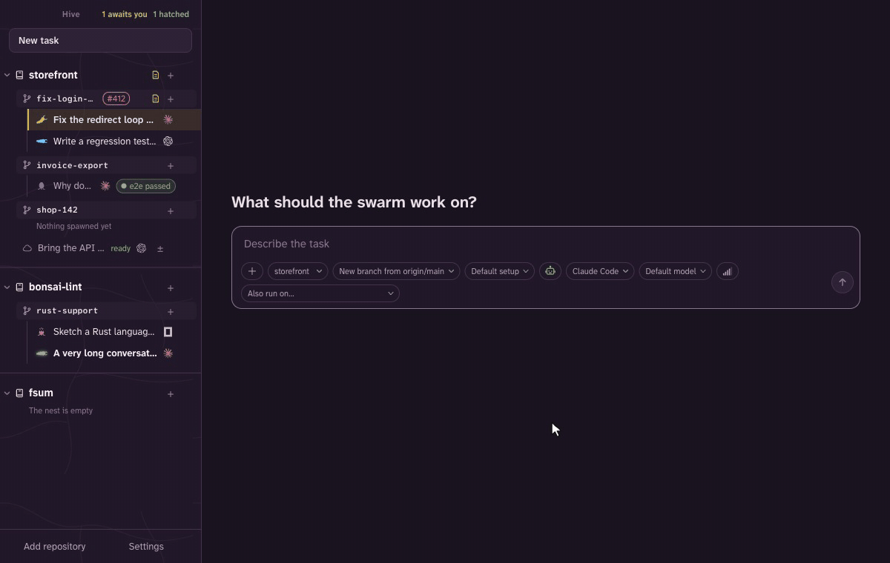

# Swarmed


**Run coding agents side by side, each on a branch and in a worktree of its own.**

Give Swarmed a git repository and say what you want done. It creates a branch and a worktree for
the task, sets it up with ports of its own, and starts an agent there: Claude Code, Codex,
OpenCode, Antigravity or any agent that speaks the Agent Client Protocol. Run several tasks at
once: each has its own worktree and ports, so they don't step on each other. A desktop app and a
`swarmed` command, over one Rust core.

[](https://github.com/ryckakas/swarmed/releases/latest)
[](https://github.com/ryckakas/swarmed/actions/workflows/ci.yml?query=branch%3Amain)
[](https://github.com/ryckakas/swarmed/actions/workflows/codeql.yml?query=branch%3Amain)
[](https://crates.io/crates/swarmed)

[](LICENSE)



## Why this one

- **A task is a branch, a worktree and a stack.** Your setup hook runs in each new worktree,
  your dev server keeps running beside it, and every task gets ports of its own, so two of them
  can run the same app at once. Agents keep to their task's worktree, so skills that make a
  worktree or branch of their own are best left out:
  [see why](docs/coding-agents.md#skills-that-make-their-own-worktree-or-branch).
- **Any agent, on its own login.** Claude Code runs as you set it up, with your login,
  settings and plugins. Others are installed and set up from Settings → Agents. Swarmed never
  signs you in to anything and keeps no GitHub token: it uses each agent's own login and your
  `gh`.
- **One pool of MCP servers and skills.** A server set up for Claude Code, Codex or OpenCode
  reaches the other agents too, and so does a skill, without copying anything into their
  configuration.
- **Supervise from one window.** Permission requests, questions and plans are answered in the
  conversation, and a notification says when a session needs you.
- **Sessions outlive a restart.** Every session is kept on disk with its whole conversation, and
  its task's worktree stays where it was, so quitting Swarmed or restarting the machine loses
  none of them. Write to a session afterwards and its agent carries on where it left off:
  Claude Code, Codex and OpenCode pick up their own conversation, and a turn the restart cut
  short no longer shows as working. For an agent that cannot resume, fork the session: the fork
  starts with the conversation so far, on the same agent or another. A turn that went the wrong
  way can be taken back: the session goes back to before your message, its files too if you
  choose, and the message waits in the box to be changed and sent again.
- **Answers you can see.** An agent can answer with HTML, such as a chart, a table or a mock-up,
  and Swarmed shows it in the conversation, in a sandbox with no way out to the app or the
  network. Apps that MCP servers attach to their tools show under the call, sandboxed the same
  way.
- **A browser per task.** Each task can have a Chrome of its own, shown live beside its
  sessions: click and type in its page, read its console. Its profile is the task's own, so
  what you sign in to there stays with the task and never reaches another's. Agents' own
  browser tools, Playwright MCP and Chrome DevTools MCP, act in it instead of opening windows,
  so you watch them work. Pick an element on its page to point the agent at exactly that one,
  with a picture of it.
- **From issue to pull request.** A task started from one of the repository's GitHub issues,
  the task's diff, comments on lines sent back to the agent, commit, push, a pull request with
  its checks that closes the issue, and merging it, now or once its checks pass.
  A finished task is put away, its agents and stack stopped and nothing deleted, by hand or by
  itself once its pull request merged or it sat idle, if you turn that on.
- **Chats, with no repository.** New task starts a chat unless you pick a repository: for a
  question, a repository you have not added, or several agents' opinions on one thing. Each
  chat gets an empty folder of its own and is listed under General. A chat can read and message
  the sessions in your repositories, which can answer it, and when it turns into work, it
  carries on in a new task of a repository with the whole conversation.
- **Made yours, by hand or by an agent.** Six palettes, a layout of your own sizes, fonts and
  colours, and a stylesheet of your own for the rest; the terminal and the status line; buttons
  that send a prompt or run a command; saved prompts, rules for every agent, and environments for
  setting tasks up. Change them in the app, in their files or with `swarmed`, or ask an agent: it
  changes the looks at once, apart from your stylesheet, which only you change, and proposes
  rules, environments and commands for your yes.
- **No files of its own in your repository.** Swarmed keeps its configuration and state in a
  folder of its own. The repository gains only the tasks' branches (and an empty first commit
  if it had none), and their worktrees live under `~/swarmed`, beside the chats' folders.

<picture>
  <source media="(prefers-color-scheme: dark)" srcset="docs/images/app-dark.png">
  
</picture>

## Install

```sh
curl -fsSL https://raw.githubusercontent.com/ryckakas/swarmed/main/install.sh | sh
```

puts Swarmed.app in `/Applications` (`~/Applications` when that cannot be written to) and links
the `swarmed` command into `~/.local/bin`. Or with Homebrew, which puts `swarmed` on the PATH as
well:

```sh
brew install --cask ryckakas/tap/swarmed
```

Swarmed then updates itself: it installs a new version when you quit, or from About at once
(Settings → About turns that off). Running the install script again updates it too.

`cargo install swarmed` builds the command alone. The releases are built for macOS so far, so
elsewhere that is how to get the command.

Swarmed is not signed with an Apple Developer ID yet. Installed with Homebrew or downloaded by
hand, macOS stops it the first time it opens: allow it under System Settings → Privacy & Security
→ Open Anyway.

## Get started

Swarmed runs agents you have installed and signed in to yourself; Claude Code is the default.
Open the app, add a repository, start a task and say what the agent should do. Or press New task
with no repository picked, which starts a chat. The app speaks
in swarm words, unless Icons and words in Settings → Appearance is set to Boring: adding a
repository is **Found a colony**, a new task **New brood**.

Or from a terminal:

```sh
swarmed project add ~/code/shop
swarmed task new shop fix-login
swarmed session run shop fix-login "Fix the login form's error message"
```

## Documentation

The documentation site is at **[swarmed.kauneckas.dev](https://swarmed.kauneckas.dev)**. It is
written from the files below, which can also be read here:

- [Projects and configuration](docs/configuration.md): hooks, ports, environments and where
  Swarmed keeps things
- [Coding agents](docs/coding-agents.md): adding agents, MCP servers, skills, and the tools
  Swarmed gives them
- [The `swarmed` command](docs/command.md)
- [Architecture and development](docs/architecture.md): how it is built, and building it
- [Security](SECURITY.md): what Swarmed keeps, what it hands on, and reporting a vulnerability
- [Changelog](CHANGELOG.md): what changed in each release

## License

MIT
