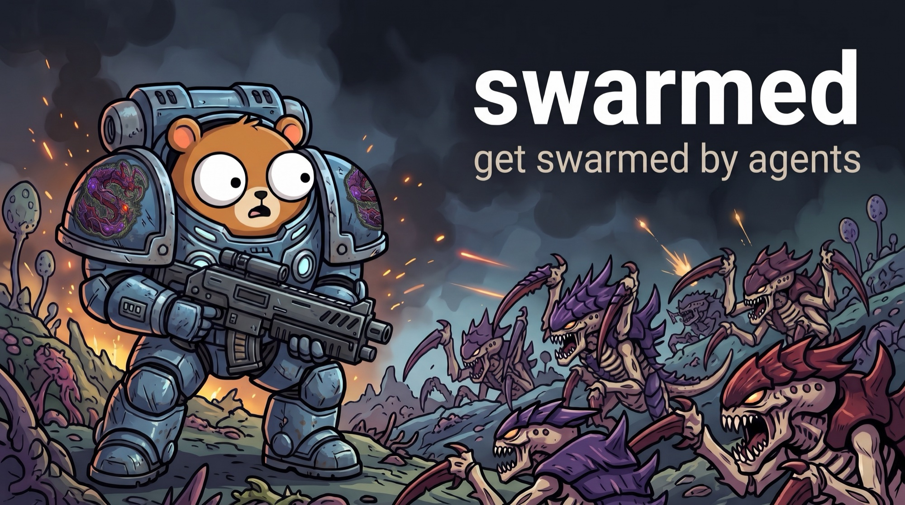

# Swarmed



Coding agents side by side on macOS, each in a git worktree of its own with an isolated dev
stack: Claude Code, Codex, OpenCode, Antigravity or any agent that speaks the Agent Client
Protocol. A desktop app and a `swarmed` command over one Rust core.

## Install

```sh
curl -fsSL https://raw.githubusercontent.com/ryckakas/swarmed/main/install.sh | sh
```

puts Swarmed.app in `/Applications` (`~/Applications` when that cannot be written to) and links
the `swarmed` command into `~/.local/bin`. Run it again to update. Or with Homebrew, which puts
`swarmed` on the PATH as well:

```sh
brew install --cask ryckakas/tap/swarmed
```

`cargo install swarmed` builds the command alone.

Swarmed is not signed with an Apple Developer ID yet. Installed with Homebrew or downloaded by
hand, macOS stops it the first time it opens: allow it under System Settings → Privacy & Security
→ Open Anyway.

What changed in each release is in [CHANGELOG.md](CHANGELOG.md).

## Layout

- `crates/core` — `swarmed-core`, the headless core. No UI dependency.
- `crates/cli` — `swarmed`, the command, a thin front end over the core.
- `crates/app` — `swarmed-app`, the desktop app: a Tauri shell over the core.
- `ui` — the app's front end, in React and TypeScript.

## The command

```sh
swarmed project add /path/to/repo
$EDITOR "$(swarmed project config <project>)"
swarmed task new <project> <task>
swarmed task list <project>
swarmed session run <project> <task> "<prompt>"
swarmed session send <session-id> "<prompt>"
swarmed task rm <project> <task>
```

From a checkout, `cargo run -p swarmed --` stands in for `swarmed`.

Sessions run your installed `claude` with its own login and configuration. `--auto` uses Claude
Code's auto mode; without it, file edits go through and other actions ask. Set
`SWARMED_FAKE_AGENT=1` to try the commands against a scripted agent that spends no tokens.

Worktrees are created under `~/swarmed/<project>/<task>`. Config and state live in
`~/Library/Application Support/swarmed/`; nothing is written into your repositories.
`SWARMED_DATA_DIR` and `SWARMED_WORKTREES_DIR` override both locations.

## Building the app

```sh
corepack enable && pnpm install
pnpm app            # builds and opens the app
pnpm dev            # the UI alone in a browser, on sample data
```

[RELEASING.md](RELEASING.md) says how a release is made.

## Other agents

Sessions run on Claude Code unless told otherwise. Any agent that speaks the
[Agent Client Protocol](https://agentclientprotocol.com) can be added in `agents.toml` in the data
directory (`swarmed agents` prints its path):

```toml
[opencode]
name = "OpenCode"
command = "opencode"
args = ["acp"]
models = ["openrouter/openai/gpt-5.6"]   # offered in the model menu

[opencode.env]                           # optional extra environment for the agent
# OPENROUTER_API_KEY = "..."
```

OpenCode can also be installed and given its models from Settings → Agents, without editing
the file.

The agent keeps its own credentials: sign in with the agent's own command first (for OpenCode,
`opencode auth login`). It then appears in the app's agent menu and as `--agent opencode` in the
CLI.

What such a session gets:

- **MCP servers:** one pool for every agent. When a session starts, Swarmed reads the servers
  configured for Claude Code (your own, the repository's `.mcp.json`, yours for that
  repository, and the ones its plugins bring), for Codex and for OpenCode, and hands the
  session's agent the ones it does not have by that name. Nothing is copied into an agent's
  files. Set `shared_mcp_servers = false` on an agent to turn that off. HTTP servers only go
  to agents that accept them, and a server you signed in to in a browser stays signed in only
  in the agent you did that in.
- **Skills:** nothing to do for agents that read `~/.claude/skills` and `.claude/skills`
  themselves, which OpenCode and Goose do.
- **Not available:** claude.ai connectors, which are signed in through your Anthropic account,
  and Claude Code's hooks.

## Development

```sh
cargo fmt --all
cargo clippy --workspace --all-targets --all-features -- -D warnings
cargo test --workspace --all-features
```

`CLAUDE.md` lists the remaining checks CI runs (docs, cargo-deny, cargo-shear, typos, taplo,
shellcheck, zizmor, actionlint) and the lint policy.
